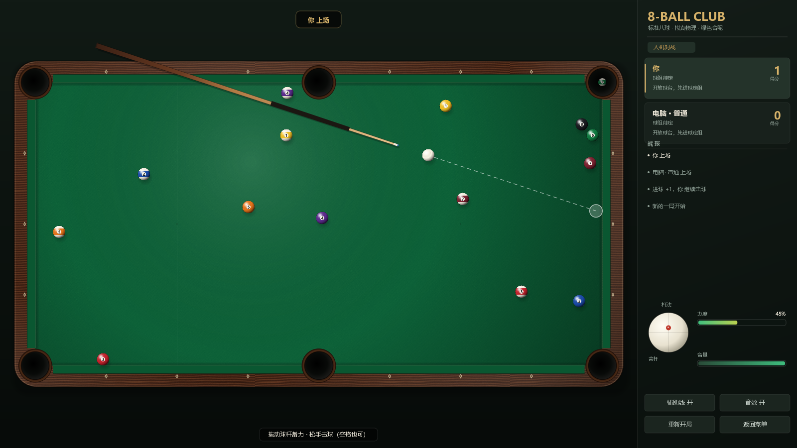

# 8-BALL CLUB · Java 标准八球

一个用纯 Java（Swing 2D，无任何第三方依赖）从零实现的拟真八球台球游戏：
**绿色台呢、木框球桌、真实滚动摩擦与库边反弹、WPA 标准八球规则、带物理推演的电脑对手、局域网/互联网双人对战。**



---

## 1. 运行

### 方式 A：直接运行（仓库内已带编译好的 jar）

双击桌面上的 **8-BALL CLUB** 图标，或双击项目里的 **`run.bat`**。

桌面快捷方式由 `make-shortcut.ps1` 创建（指向 `javaw.exe -jar dist\8-ball-club.jar`，
图标为 `assets\8ball.ico`，快捷键 `Ctrl+Alt+8`）。如果移动了项目目录或更换了 JDK，
重新运行一次即可：

```powershell
powershell -ExecutionPolicy Bypass -File make-shortcut.ps1
```

`run.bat` 会依次尝试：`.jdk-home` 中记录的 JDK → `JAVA_HOME` → `PATH` 中的 Java →
常见的 JDK 安装目录（含 JetBrains 自带的 JBR）。也可以用命令行运行：

```bat
java -jar dist\8-ball-club.jar
```

需要 **Java 17 或更高版本**（只用到 `java.desktop`，无需 JavaFX）。

### 方式 B：从源码构建

```powershell
powershell -ExecutionPolicy Bypass -File build.ps1
```

脚本会自动寻找 `javac`（支持 `JAVA_HOME`、PATH、Program Files、JetBrains JBR 等位置），
编译到 `out/classes`，打包成 `dist/8-ball-club.jar`，并把 JDK 路径写入 `.jdk-home`。

```powershell
powershell -ExecutionPolicy Bypass -File build.ps1 -Test   # 构建并运行 38 项自测
powershell -ExecutionPolicy Bypass -File build.ps1 -Jdk "C:\Program Files\Java\jdk-21"  # 指定 JDK
```

Linux / macOS：`./build.sh && ./run.sh`。

---

## 2. 操作

| 操作 | 说明 |
| --- | --- |
| 移动鼠标 | 瞄准（母球指向鼠标方向） |
| 按住左键向**球杆后方拖动** | 蓄力，拉得越远力度越大 |
| 松开左键 | 击球 |
| 方向键 ← → | 微调角度（按住 Shift 更精细） |
| 方向键 ↑ ↓ | 调整力度 |
| 空格 | 按当前力度击球（力度为 0 时自动用 55%） |
| 右下角「杆法」圆盘 | 点击设置高杆 / 低杆 / 左塞 / 右塞 |
| 自由球 | 移动母球到合法位置后点击放置（开球犯规时只能放在开球线后） |
| 8 号球叫袋 | 该你打 8 号球时，袋口会闪烁，点击目标袋口完成叫袋 |
| A / M | 开关辅助线 / 音效 |
| Esc | 返回主菜单 |

辅助线会显示：进球线、幽灵球（母球碰撞位置）、目标球走向、母球分离方向。

---

## 3. 规则实现（WPA 标准八球）

- **开球**：母球必须放在开球线后；合法开球要求先碰到球堆，并且至少进一颗球或至少四颗球碰库。
- **开放球台**：开球后球台始终开放，开球之后第一次合法进球才决定球组（全色 1–7 / 花色 9–15）。
- **犯规**（对手获得自由球，可任意摆放母球）：
  - 母球落袋；
  - 空杆（没有碰到任何球）；
  - 先碰到对方的球 / 开放球台先碰 8 号 / 清台后先碰的不是 8 号；
  - 击球后既没有球进袋，也没有任何球碰库；
  - 开球不合法（此时对手的自由球限制在开球线后）。
- **继续击球**：合法进球可以继续；只打进对方的球不算犯规，但交换击球权。
- **8 号球**：
  - 开球时打进 8 号不算输，8 号重新摆回置球点并继续击球；
  - 清完自己组后，必须**叫袋**把 8 号打进指定袋口才获胜；
  - 提前打进 8 号、8 号进错袋、或打进 8 号的同时犯规 → 判负。
- 母球落袋后自动回到台面，由对手以自由球方式重新摆放。

规则判定核心在 `rules/Rules.java`，与物理引擎完全解耦，方便单独测试。

---

## 4. 联机对战

1. 一方点击 **创建联机房间**，窗口会显示本机 IP 与端口（默认 `24680`），等待好友加入。
2. 好友点击 **加入联机房间**，输入房主的 IP（可写成 `192.168.1.10:24680`）。
3. 连接成功后自动开局，房主先开球。

实现方式：

- **房主权威**：房主负责规则判定和最终比分，客户端只发送击球参数。
- **双端同演**：每一杆开始时，房主广播「杆法 + 本杆起始局面」，两端用**同一套确定性物理引擎**各自推演动画，因此画面流畅、不吃带宽。
- **对账**：一杆结束后房主广播权威结果快照（球位、球组、球权、比分），客户端据此校正，彻底避免浮点漂移。
- 协议为长度固定的二进制小包（TCP），实测 8 杆连续对局球位误差为 `0.000000 m`。

跨互联网对战需要房主在路由器上把 **TCP 24680** 端口映射到本机，并在 Windows 防火墙中放行 Java；
只想局域网玩则无需任何设置。

---

## 5. 技术实现

### 5.1 物理引擎（`core/Physics.java`）

- 单位：米、秒、千克；九尺台面 2.54 m × 1.27 m，球半径 28.575 mm，球重 170 g。
- **滑动 / 滚动两阶段摩擦模型**：用球体与台呢接触点的相对速度 `u = v + ω × r` 判断滑动，
  滑动时以 `3.5 μg` 的速率衰减 `u`，归零后进入纯滚动，再由滚动阻力减速。
  这样高杆会跟球、低杆会缩杆，是“真实感”的主要来源。
- **侧旋（塞）**：独立的竖直轴角速度，在库边碰撞时产生切向“甩球”，并随时间衰减。
- **球球碰撞**：沿法线的恢复系数 0.95 + 切向摩擦（可产生轻微“甩球”）。
- **库边**：恢复到 0.74，带切向摩擦和侧旋修正；袋口处库边断开。
- **防穿透**：按当前最大速度自动细分时间步（每步位移 < 0.45 R），高速开球也不会穿球/穿库。
- **落袋判定**：角袋用 `x+y` 阈值，中袋用“袋口宽度 + 贴近库边”判定，避免球从袋口前方“隔空落袋”。

### 5.2 电脑对手（`ai/Ai.java`）

不是简单的规则脚本，而是**用与真实对局完全相同的物理引擎做搜索**：

1. 枚举「目标球 × 袋口」组合，计算幽灵球位置，检查母球线路和目标球线路是否被挡；
2. 对每个候选，尝试若干角度微调与力度倍率，**完整推演到所有球停止**；
3. 按「是否进袋 / 是否犯规 / 母球是否落袋 / 是否误进 8 号 / 下一杆走位好坏」打分，取最优；
4. 三档难度只改变候选数量与瞄准误差（简单约 ±1.7°，普通 ±0.6°，高手 ±0.16°）；
5. 没有进球机会时自动打安全球；自由球时会搜索合法且有利的母球摆放点。

推演跑在 SwingWorker 后台线程，不卡界面；普通难度平均每杆约 20–50 ms。

### 5.3 渲染（`ui/Art.java`、`ui/GamePanel.java`）

- 所有材质**程序化生成**，没有任何图片资源：
  - 台呢：逐像素噪声 + 织纹 + 径向灯光 + 暗角；
  - 木框：正弦木纹 + 细纹理 + 高光/倒角 + 贝母菱形库钉；
  - 球体：径向渐变球面、镜面高光、号码白圈、花色球中带、软阴影；
  - 袋口：皮革外圈 + 径向渐变的深洞；
  - 球杆：锥形木杆、缠线握把、先角、蓝色皮头。
- 球桌底图按窗口尺寸缓存为 `BufferedImage`，每帧只重绘球、球杆和 HUD。
- 支持任意窗口大小，布局按比例自适应；1600×900 默认，最小 1180×700。

### 5.4 音效与音乐（`audio/SoundFx.java`）

纯代码合成 44.1 kHz PCM（无音频文件）：撞球脆响、撞库闷响、落袋下坠、出杆击球、按钮点击、
获胜 / 失败 jingle，以及 8 秒循环的背景轻音乐（C–Am–F–G 分解和弦）。按碰撞强度调音量，
高频音效使用多实例 Clip 池避免快速连击互相打断；没有声卡时自动静音，不影响游戏。
「音效」开关（或 M 键）统一控制所有声音。

### 5.5 联机（`net/NetGame.java`、`net/Snapshot.java`）

- TCP + 自定义二进制协议（HELLO / START / SHOT / RESULT / BYE）；
- 房主 `ServerSocket` 监听，客户端 8 秒连接超时；
- 所有网络回调通过 `SwingUtilities.invokeLater` 切回 EDT，物理与渲染只在 EDT 运行。

---

## 6. 目录结构

```
java-pool/
├── build.ps1 / build.sh          构建脚本
├── run.bat / run.sh              启动脚本
├── selftest.bat                  运行自测
├── dist/8-ball-club.jar          已打包的可执行 jar
├── screenshots/                  界面截图
└── src/main/java/com/pool8/
    ├── Main.java                 入口（--selftest / --screenshot）
    ├── SelfTest.java             36 项物理 / 规则 / AI 自测
    ├── core/                     Ball / Table / World / Physics / Shot / ShotTracker
    ├── rules/                    Group / Rules / Outcome / Match
    ├── ai/Ai.java                物理推演式 AI
    ├── net/                      NetGame / Snapshot
    ├── audio/SoundFx.java        程序化音效
    └── ui/                       GamePanel / MenuPanel / MainFrame / Art / Theme / RulesDialog
```

---

## 7. 测试

```bat
selftest.bat
```

覆盖：摆球合法性、正碰动量传递、库边不穿透、落袋、高低杆（缩杆/跟球）、开球散球、开放球台定组、
先碰对方球犯规、空杆犯规、过早进 8 号判负、叫袋进 8 号获胜、未叫袋判负、母球落袋后自由球、
AI 杆法合法性、AI 对局推进等共 **38 项**，当前全部通过。

另外还有两个开发用冒烟测试（不打包进发行 jar）：

```bat
java -cp out\classes com.pool8.InputSmokeTest   :: 合成鼠标事件，测试摆球/瞄准/蓄力/杆法
java -cp out\classes com.pool8.UiSmokeTest     :: 电脑自我对弈一整局
java -cp out\classes com.pool8.NetSmokeTest    :: 双端联机 8 杆并核对同步
```

离屏截图（无需显示器）：

```bat
java -Djava.awt.headless=true -cp dist\8-ball-club.jar com.pool8.Main --screenshot shots
```

---

## 8. 已知限制

- 采用 2D 俯视视角 + 球体光影，不是 3D 建模；但物理、球桌比例和袋口尺寸按真实九尺台设定。
- 未实现跳球、扎杆（ masse ）和“三犯”规则；跳球/扎杆在多数业余对局中也极少使用。
- 联机是房主权威的点对点模式，没有中心服务器与匹配大厅；跨公网需要端口映射。
- 联机暂不支持观战、聊天和断线重连。

---

## 9. 常见问题

**双击 run.bat 没反应 / 提示找不到 Java**
安装 JDK 17+（<https://adoptium.net>），或先运行 `build.ps1`，脚本会把可用的 JDK 路径写入 `.jdk-home`。

**创建房间后好友连不上**
确认在同一局域网、IP 填写正确、Windows 防火墙允许 Java；跨公网需要在路由器上映射 TCP 24680。

**觉得球太快 / 太慢**
物理常数集中在 `core/Physics.java`（`MU_SLIDE`、`MU_ROLL`、`E_CUSHION`、`MAX_CUE_SPEED`），改完重新构建即可。

**想调 AI 强度**
`ai/Ai.java` 的 `EASY / NORMAL / HARD` 三个参数控制候选数量与瞄准误差。
